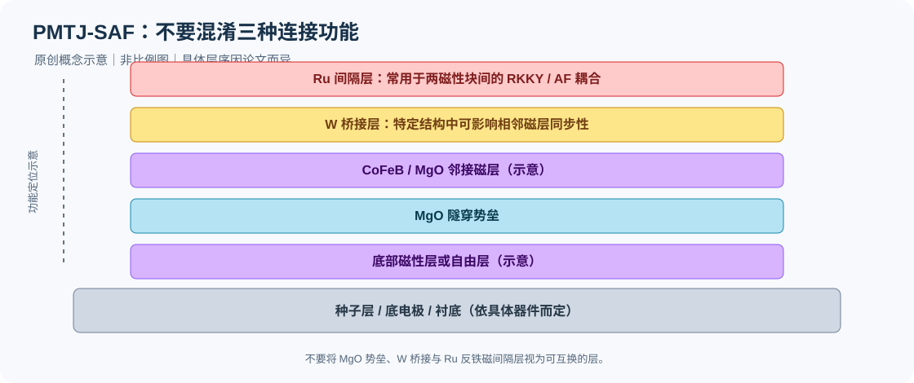

# 01｜PMTJ-SAF整体结构设计与优化

阅读范围：公开研究。以下不涉及用户样品。推荐顺序：[Wang et al., 2018 · SRC-000002](../library/records/SRC-000002.md) → [Devolder et al., 2016 · SRC-000011](../library/records/SRC-000011.md) → [Chatterjee et al., 2018 · SRC-000001](../library/records/SRC-000001.md) → [Chatterjee et al., 2021 · SRC-000004](../library/records/SRC-000004.md) → [Cuchet et al., 2016 · SRC-000003](../library/records/SRC-000003.md)。

## 图1｜PMTJ参考系统中三类磁性连接的概念示意

<small>图示为本库原创的概念示意，不代表某一篇论文的完整实际膜堆，也不按比例绘制。各论文的具体层序与厚度请以对应文献记录及原文图注为准。</small>

## 1. 首先区分三种结构任务

隧穿界面、参考层内部的FM桥接、SAF块间AF耦合是不同任务。Wang 2018在同一器件内同时使用参考侧W0.25nm bridge和自由侧W0.2nm spacer；作者用Fig.1c minor loop支持后者两个CoFeB自由层同步翻转，不能将该证据自动归给前者。完整层序和器件/blank-film条件见SRC-000002 pp.2–3、Fig.1及SI Note2。

Devolder 2016将固定系统分为PL、RL、HL，分别通过Ta与Ru连接（SRC-000011 p.1、Table I）。这是理解“参考层”一词歧义的入口：一个MgO邻接自旋极化层，与整套固定系统，不应总被同一RL标签替代。该论文结合FMR和模型约束各部分，而非只凭总回线台阶归属。

## 2. 不同设计路线解决不同问题

| 路线 | 实际结构与证据 | 作者支持的内容 | 可比性边界 |
|---|---|---|---|
| 两组Co/Pt的常规SAF | SRC-000002 Fig.1；Co/Pt/Ru/Co/Pt/W/CoFeB | 完整器件磁性、R-H与STT结果可关联 | 自由层W与参考侧W分开；不能把TMR峰当桥接J峰 |
| Ru/W薄SAF | SRC-000001 Fig.1(a–f)、Figs.2–3 | 多功能Ru/W连接Co/Pt与FeCoB；计算与器件测量比较杂散场 | 这里W参与AF耦合层，少了一组Co/Pt；非简单替换常规W桥 |
| seedless顶部参考层 | SRC-000004作者稿Figs.2–5；SI S1–S4 | Co/Ta/Pt插层改善该顶生长结构的磁性与热处理表现 | 不等同于在厚Pt种子上生长的Co/Pt |
| FeCoB型SAF参考 | SRC-000003 Figs.1–7 | 从SAF存储层到参考层、再到去Pt/Pd设计的实验路线 | 间隔层相邻材料改变；不能继承Co/Pt的最佳Ru厚度 |

这些路线共享“稳定参考态并控制自由层受扰”的目标，但磁矩补偿、PMA、交换、器件杂散场和可制造性不是同一优化指标。本库综合判断：应先按结构任务建立可比组，再讨论厚度数值优劣；此为跨文献组织方法，不是新的实验结论。

## 3. 薄膜磁补偿与器件场补偿要分开

SRC-000001 Fig.1(d–f)为宏自旋杂散场计算，Fig.7为器件尺寸相关测量；计算结果与实测的角色分别记录。SRC-000003 p.6又明确提醒：SAF2的磁矩补偿，与硬参考层为小尺寸器件减杂散场而采用的轻微不补偿，不应混同。因此不能从blank-film零平台直接宣布器件自由层偏置最小，也不能以层厚总和相等代替有效磁矩相等。

## 4. 热处理与可辨识性

SRC-000011 Fig.1的回线变化较小，FMR模却显示参数显著演化；SRC-000002 Fig.5和SI Note8提供结构/元素分布层面的证据。两者分别支持“需要多种表征”和“特定W结构的材料稳定性”，不能仅凭W与Ta材料名称就推得跨工艺优劣。ACS 2021还区分顶参考层与自由层的热稳定性（SRC-000004 Fig.5），整膜仍有台阶不表示每一部分都优化完毕。

## 5. 下一步阅读问题

优先补齐不同路线对参考层扰动、图形化后杂散场和耐退火性的共同评价口径。SRC-000002正文与SI Note2存在stack A/B命名及器件选择描述差异，需核对图像与作者版本，不自行合并。会议/讲座只作线索，不用其摘要替代器件证据。

相关专题：[W桥与spacer](02-w-ferromagnetic-coupling.md) · [Ru耦合](03-ru-antiferromagnetic-coupling.md) · [磁矩与翻转](05-moment-and-reversal.md)。

[专题入口](../index.md) · [缺失材料](../gaps/missing-materials.md) · [未解决证据](../gaps/unresolved-evidence.md)

## 参考文献格式

文中链接已改为“第一作者姓氏 et al., 年份 · 资料编号”的作者—年份形式；资料编号仅用于回到本库的证据记录。完整书目信息见[参考文献表](../references.md)。
