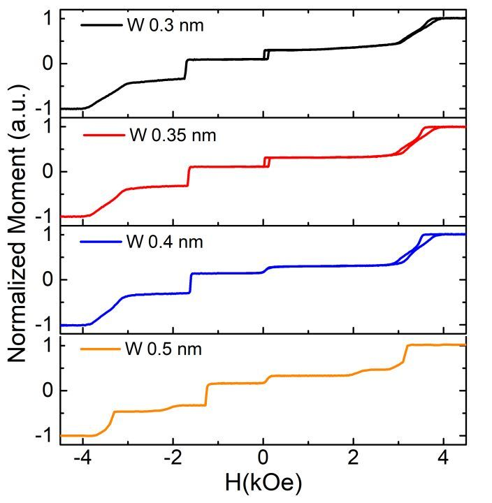

# 02｜CoFeB/W/CoPt的铁磁耦合及W厚度效应

优先阅读：[Chatterjee et al. (2021)](../library/records/SRC-000004.md) SI Fig.S2 → [Wang et al. (2018)](../library/records/SRC-000002.md) Fig.1 → [Chatterjee et al. (2018)](../library/records/SRC-000001.md) Figs.2–3。本专题聚焦公开文献证据，不对特定实验样品作诊断。

## 1. 同为W，不能混成一种耦合曲线

| W的位置 | 核对来源 | 相邻材料与功能 | 本轮可作何种判断 |
|---|---|---|---|
| 顶参考层纹理打断/桥接 | [Chatterjee et al. (2021)](../library/records/SRC-000004.md) SI S2 | FeCoB/W/[Co/Ta/Pt]3及其上方Ru-SAF | 直接相关的参考层厚度与翻转证据，但插Ta多层须明示 |
| 自由层间隔 | [Wang et al. (2018)](../library/records/SRC-000002.md) Fig.1c | CoFeB/W/CoFeB | minor loop支持0.2nm自由层同步，非CoFeB/W/CoPt定量证据 |
| 多功能AF间隔层之一 | [Chatterjee et al. (2018)](../library/records/SRC-000001.md) Fig.2、SI S1 | Co/Pt/Ru/W/FeCoB | Ru与W共同控制AF耦合，不能当W单独FM桥 |

这是本专题最重要的文献分组。一个数值处于0.2–0.6nm范围，并不使这些体系可直接比较。

## 2. 重新核对[Chatterjee et al. (2021)](../library/records/SRC-000004.md) Fig.S2

官方SI已下载并目视核对S2页：图注明确是**normalized ascending branch**，W为0.3、0.35、0.4、0.5nm，退火400°C。实际磁层为FeCoB1.1/W(t)/[Co0.6/Ta0.2/Pt1.1]3/Co0.6/Ru0.9/Co0.6/Pt0.25/[Co0.5/Pt0.25]6（nm）；完整层序见主记录。

作者在图上段明确把0.5nm样品解释为FeCoB与Co/Ta/Pt多层不能保持同步，并将该pSAF的优化W范围置于0.35–0.4nm。这是作者基于特定结构的结果和解释。本库没有据此给每个负场台阶指定具体层，也没有将其升级为所有CoFeB/W/CoPt的阈值。

SI S1另研究五重复SL-MLs，给出的W限制与S2不同。两页的多层次数、Pt厚度和有无完整pSAF环境都变了，不能从0.6nm与0.4nm两个数字宣称原文自相矛盾。

!!! note "原文图｜Chatterjee et al. (2021)，Fig. S2"

    [{ loading=lazy }](https://acs.figshare.com/articles/journal_contribution/Unconventional_Seedless_Multilayers_with_Large_Perpendicular_Anisotropy_for_Back-End-of-Line_Compatible_Spintronic_Devices/16934265)

    **出处：** [Chatterjee et al. (2021)](../library/records/SRC-000004.md)，*Unconventional Seedless Multilayers with Large Perpendicular Anisotropy for Back-End-of-Line Compatible Spintronic Devices*，Fig. S2，SI PDF p.2。[原图与图注](https://acs.figshare.com/articles/journal_contribution/Unconventional_Seedless_Multilayers_with_Large_Perpendicular_Anisotropy_for_Back-End-of-Line_Compatible_Spintronic_Devices/16934265) · [出版PDF定位](https://ndownloader.figshare.com/files/31329801#page=2) · [DOI](https://doi.org/10.1021/acsaelm.1c00578)。

    **原文图注要点／直接证据：** 400°C退火的顶参考MTJ，W=0.30、0.35、0.40、0.50nm；图注明确是归一化磁化回线的上升支。相邻多层是Co/Ta/Pt，不能省略Ta。

    **作者解释：** S2页图上段把0.50nm样品解释为FeCoB与Co/Ta/Pt不能保持同步翻转，并在该结构中选择0.35–0.40nm。

    **本库分析与限制：** 不将这个范围推广到所有无Ta的CoFeB/W/CoPt，也不凭负场台阶给每层强行归属。仅从PDF提取该嵌入JPEG，未重绘或修改图内像素；原文图注另以中文概述。

    **版权与改动：** Chatterjee et al. (2021)，原文Fig. S2；[CC BY-NC 4.0](https://creativecommons.org/licenses/by-nc/4.0/)，依据[官方许可登记](https://api.figshare.com/v2/articles/16934265)。图内内容保持原样，中文仅为旁列概述。

## 3. 跨文献比较与证据强度

[Wang et al. (2018)](../library/records/SRC-000002.md) pp.2–3展示blank-film OOP/IP与minor loop；其自由层结论由磁性测量支持，原子结构的输运计算另有简化，SI Note6省略顶部MgO。其W厚度相关TMR计算（SI Note9、Table1）更不能改名成“参考层FM交换常数曲线”。

[Chatterjee et al. (2018)](../library/records/SRC-000001.md)的Ru/W体系则出现另一种权衡：W减薄可增大AF耦合，却可能不足以完成纹理打断；移除W时FeCoB翻转倾斜（正文p.3及SI S2）。作者对界面混合、织构等机制的讨论应保留“解释”身份，不能由该现象反向断言任何倾斜MOKE都源于W耦合差。

本库综合判断：对W桥有效性的比较应同时查看minor loop、各层磁矩/PMA、厚度对照及结构表征；“存在两个台阶”“TMR下降”均不足以单独量化J_W。此判断是对证据链的要求，不构成对任何特定样品的诊断。

!!! note "原文图｜Chatterjee et al. (2018)，Fig. 2"

    [{ loading=lazy }](https://www.nature.com/articles/s41598-018-29913-6/figures/2)

    **出处：** [Chatterjee et al. (2018)](../library/records/SRC-000001.md)，*Novel multifunctional RKKY coupling layer for ultrathin perpendicular synthetic antiferromagnet*，Fig. 2，PDF p.3。[原图与图注](https://www.nature.com/articles/s41598-018-29913-6/figures/2) · [出版PDF定位](https://www.nature.com/articles/s41598-018-29913-6.pdf#page=3) · [DOI](https://doi.org/10.1038/s41598-018-29913-6)。

    **原文图注要点／直接证据：** 340°C退火后，横轴为Ru厚度，不同曲线对应不同W厚度；纵轴为作者按其定义提取的RKKY面交换能。

    **作者解释：** 作者用该图讨论Ru/W双间隔层的反铁磁耦合及厚度权衡。

    **本库分析与限制：** 这是Ru/W多功能AF间隔，不能与上面的FM桥接Fig. S2合并为一条W厚度曲线；J提取依赖原文Ms、磁层厚度和场定义。

    **版权与改动：** Chatterjee et al. (2018)，原文Fig. 2；[CC BY 4.0](https://creativecommons.org/licenses/by/4.0/)，依据[官方许可登记](https://www.nature.com/articles/s41598-018-29913-6#rightslink)。图内内容保持原样，中文仅为旁列概述。

## 4. 尚缺什么

当前直接证据较强的是Co/Ta/Pt seedless结构；仍需扩展无Ta插层的CoFeB/W/普通Co/Pt桥接实验、独立耦合提取和结构分析。需要把桥接J、厚度连续性、B吸收与PMA四种证据分列，避免一个结果同时充当四种机制证明。

相关专题：[整体结构](01-pmtj-saf-design.md) · [PMA优化](04-copt-pma-optimization.md) · [翻转实验](05-moment-and-reversal.md)。

[专题入口](../index.md) · [证据缺口](../gaps/unresolved-evidence.md)

## 5. 本批补读：封盖、桥接与MgO耦合继续分开

[Chatterjee et al. (2017)](../library/records/SRC-000028.md)的W1–5nm位于自由层封盖；完整pMTJ参考侧连接仍为Ta0.3nm。Figs.2–4（HAL PDF pp.4–5）支持特定封盖的磁性/扩散讨论，不能补成CoFeB/W/CoPt桥接常数曲线。[Kim et al. (2023)](../library/records/SRC-000031.md)为更厚CoFeB的面内器件，正文与图注还存在Ta/W封盖5/4nm写法差异，保留为待核，不能替本篇S2选择阈值。

[Yang et al. (2026)](../library/records/SRC-000032.md)Methods包含W0.6nm桥，但其主要模型控制MgO两侧粗糙度相关耦合，不提供该桥的完整厚度扫描。前期标题线索[Yang et al. (2021)](../library/records/SRC-000030.md)的作者、期刊、DOI现已核实；完整正文仍未取，不用预览补出图级最优W结果。直接无Ta桥接系列仍是高优先级缺口。

[完整参考文献](../references.md) · [原图来源与核验事项](../gaps/figure-and-citation-gaps.md)
