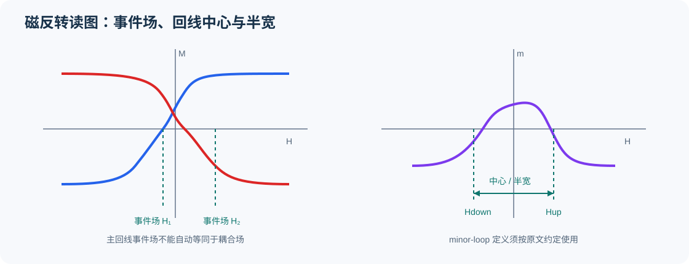

# 05｜磁矩匹配、两步/三步翻转及MOKE/M-H

主阅读：[Cuchet et al., 2016 · Cuchet et al., 2016 · SRC-000003](../library/records/SRC-000003.md) Figs.4–5 → [Chatterjee et al., 2018 · Chatterjee et al., 2018 · SRC-000001](../library/records/SRC-000001.md) Figs.3–6 → [Muehlenhoff et al., 2021 · Muehlenhoff et al., 2021 · SRC-000019](../library/records/SRC-000019.md) Figs.5–6。仅讨论公开实验。

## 图1｜磁反转事件场的概念示意

<small>原创概念图，不是论文原图或实测数据。场的定义和符号必须以各论文原文为准。</small>

## 1. 从“多一个台阶”转向实验能区分什么

Cuchet2016通过底FeCoB厚度系列、VSM内部标定、额外翻转场与净磁矩变化互相对照，见pp.4–5、Eqs.(1)–(2)、Figs.4–5。作者的补偿判断不是只凭一条总回线：Fig.5既比较Hsw，也比较归一化净磁矩；模型只给真实成核过程的上限近似。

Chatterjee2018对Ru/W薄SAF把concurrent reversal与Hex区分，并通过Pt种子层和HL重复数改变过程。其Hex2公式位于p.4且**没有编号**，不能编成Eq.(2)；Cuchet的类似公式才是该论文自己的Eq.(2)。两篇的模型关系相似，不等于样品相同或证据独立排除了所有机制。

## 2. 三个“翻转步骤”的概念不能互换

| 情形 | 来源与原文定位 | 在原文中的含义 | 限制 |
|---|---|---|---|
| 两AP态间共同反向 | Chatterjee et al., 2018 · SRC-000001 pp.4–6、Fig.3 | PL/HL concurrent reversal | 特定两块近似及磁矩/PMA条件 |
| FeCoB与邻近多层不同步 | Chatterjee et al., 2021 · SRC-000004 SI Fig.S2、S2页 | 作者用W0.5样品说明FM桥不足以同步 | 整个PMTJ有自由层和远端硬层，不能只数总台阶 |
| 多块SSF或inversion | Böhm et al., 2019 · SRC-000020 pp.3–7、Fig.3 | 强AF-IEC多块体系的空间磁态变化 | 不是N=2 Ru-SAF的一一对应机制 |

本库综合判断：台阶数只能作为待解释观测；机制比较至少要锁定扫场方向、样品结构、minor loop及独立对照。这里没有给用户曲线分层归属。

## 3. MOKE与磁矩可能朝不同方向变化

Muehlenhoff作者稿Fig.6同时给SQUID-VSM与MOKE：AP重排后，总磁矩信号与Kerr旋转的变化不同。作者将其解释为MOKE更敏感于上层。该例直接说明，AP平台高度不能未经校准就当绝对磁矩比；不能因两个测量的台阶幅度不一致就宣布数据矛盾。

同稿Fig.5的Y=8/9对照还显示，总磁化形状相近可伴随不同GMR转移曲线。MgO两侧磁化相对角、整膜净磁矩与具有深度权重的Kerr信号应作为不同观测量保存，不能强迫每个M-H台阶都在R-H中出现。

## 4. 斜率、Hc和PMA的证据边界

Shepley2015 [Shepley et al., 2015 · Shepley et al., 2015 · SRC-000026](../library/records/SRC-000026.md)用polar MOKE、EHE与Kerr畴成像分开研究回线、各向异性和畴壁。Devolder2016 [Devolder et al., 2016 · Devolder et al., 2016 · SRC-000011](../library/records/SRC-000011.md)显示回线变化小但模频率明显变。二者共同反对把单一导数峰或斜率当所有内禀参数的直接测量；这是一项证据比较结论，不是说所有斜坡都由磁畴引起。

Ma2025 [Ma et al., 2025 · Ma et al., 2025 · SRC-000010](../library/records/SRC-000010.md)把minor-loop中心与半宽分开，Fig.3用SQUID/MOKE检查温度变化。光诱导Hc变化与PMA的联系包含模型解释；即使作者提出这种联系，本库仍不把Hc当作Keff的同义词。

## 5. 可继续追踪的非期刊材料

[Hellwig, 2022 · Hellwig, 2022 · SRC-000016](../library/records/SRC-000016.md)为会议摘要，[Hellwig et al., 2022 · Hellwig et al., 2022 · SRC-000021](../library/records/SRC-000021.md)为公开视频入口，均与磁反转和畴结构有关；后者尚未逐段观看，没有已核实科学时间戳。完整报告、实验演示视频及层分辨成像仍列缺口，不以公告内容填满证据表。

相关专题：[W耦合](02-w-ferromagnetic-coupling.md) · [Ru定义](03-ru-antiferromagnetic-coupling.md) · [模型边界](06-models-and-criteria.md)。

[专题入口](../index.md) · [待核实项](../gaps/unverified-sources.md)
